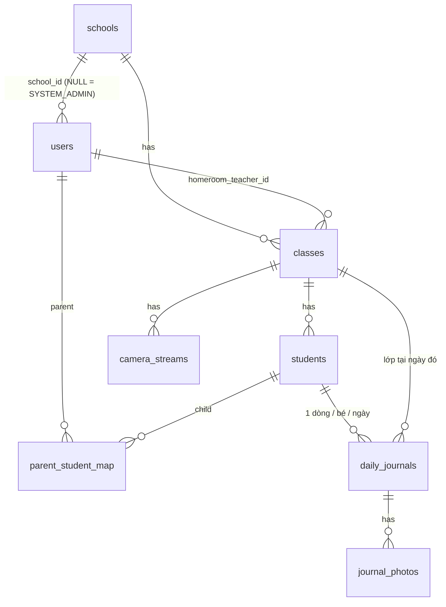

# KinderLog API — PDJRS Backend

NestJS 11 · TypeORM 0.3 · PostgreSQL 16 · Redis 7 · JWT/RBAC · Whisper + Claude (AI pipeline)

Backend của **Preschool Daily Journal & Reporting System**. Kiến trúc *Modular Monolith*: mỗi nghiệp vụ là một
NestJS module độc lập, dùng chung lớp `common/` (enum, guard, decorator, filter) và hai module toàn cục
`AccessModule` (phân quyền theo dòng dữ liệu / multi-tenant) và `CacheModule` (Redis, fail-open).

```
src/
├── main.ts                     # CORS, ValidationPipe, Swagger (/api/docs), static /uploads
├── app.module.ts               # global guards: Throttler → JwtAuth → Roles; global exception filter
├── config/configuration.ts     # .env + Joi validation
├── common/                     # enums, @Roles/@Public/@CurrentUser, guards, filter, date utils (timezone-aware)
├── database/
│   ├── data-source.ts          # dùng chung cho app và TypeORM CLI
│   ├── migrations/             # InitialSchema (8 bảng + extension unaccent)
│   └── seeds/seed.ts           # dữ liệu demo khớp FE/src/store/seed.js
└── modules/
    ├── access/                 # AccessService: SYSTEM_ADMIN > PRINCIPAL (trường) > TEACHER (lớp chủ nhiệm) > PARENT (con)
    ├── cache/                  # CacheService (Redis) cho dashboard
    ├── auth/                   # login bằng SĐT, bcrypt, JWT, đổi mật khẩu
    ├── schools/  users/  classes/  students/
    ├── daily-journals/         # bulk logging + ngoại lệ, duyệt, timeline, ảnh, AI pipeline (ai/)
    ├── camera-streams/         # khung giờ xem, trả URL HLS chỉ khi đang mở
    └── reports/                # dashboard + xuất PDF (pdfkit, font DejaVu) / Excel (exceljs)
```

## 1. Cơ sở dữ liệu (8 bảng, 3NF)



| Bảng | Vai trò | Ghi chú thiết kế |
|---|---|---|
| `schools` | Tenant gốc | Mọi truy vấn của Principal/Teacher/Parent bị giới hạn theo trường |
| `users` | 4 vai trò RBAC | `phone` unique (đăng nhập), `password_hash` bcrypt, `status` ACTIVE/INACTIVE/LOCKED |
| `classes` | Lớp + GVCN | unique (`school_id`, `academic_year`, `name`) |
| `students` | Hồ sơ trẻ | `allergies`, `medical_note`; trường suy ra qua lớp (không lặp `school_id`) |
| `parent_student_map` | N-N phụ huynh ↔ trẻ | khoá chính kép, `relationship`, `is_primary` |
| `daily_journals` | Ăn / ngủ / học / sức khoẻ / cảm xúc | unique (`student_id`, `journal_date`), `status` DRAFT/APPROVED, `is_exception`, `source` MANUAL/BULK/VOICE |
| `journal_photos` | Ảnh hoạt động | một file có thể gắn cho nhiều bé |
| `camera_streams` | Link HLS demo + khung giờ | `allowed_start_time`, `allowed_end_time`, `allowed_weekdays` (bitmask ISO) |

`daily_journals.class_id` lưu lớp **tại thời điểm ghi** (trẻ có thể chuyển lớp sau đó) nên là thuộc tính của bản
ghi, không phải phụ thuộc bắc cầu — vẫn đạt 3NF.

## 2. Chạy hệ thống

Yêu cầu: Node.js ≥ 20, Docker Desktop.

```bash
cd BE
cp .env.example .env          # đã có sẵn .env mặc định cho demo
docker compose up -d          # PostgreSQL :5432 + Redis :6379  (thêm --profile tools để có Adminer :8080)
npm install
npm run migration:run         # tạo 8 bảng
npm run seed                  # dữ liệu demo (chạy lại bất cứ lúc nào để reset)
npm run start:dev             # http://localhost:3000/api  ·  Swagger: http://localhost:3000/api/docs
```

| Lệnh | Mục đích |
|---|---|
| `npm run migration:generate` | Sinh migration mới sau khi sửa entity |
| `npm run migration:revert` | Huỷ migration gần nhất |
| `npm run db:reset` | Drop schema → migrate → seed |
| `npm run lint` / `npm run format` | ESLint / Prettier |

### Tài khoản demo (mật khẩu `123456`, giống FE)

| Vai trò | SĐT | Tên |
|---|---|---|
| SYSTEM_ADMIN | 0901000001 | Lê Quang Huy |
| PRINCIPAL | 0902000001 | Trần Thị Lan — Mầm non Kinder Stars |
| TEACHER | 0903000001 | Nguyễn Thị Mai — Mặt Trời 1 |
| TEACHER | 0903000002 | Phạm Thu Hà — Mặt Trời 2 |
| PARENT | 0904000001 | Nguyễn Thị Hương — mẹ bé Nguyễn Minh An (Mặt Trời 1) |

Phụ huynh khác: `09040000NN` (NN = 01…31). Seed tạo sẵn ~2 tuần nhật ký đã duyệt; **hôm nay lớp Mặt Trời 1 để trống**
để demo trực tiếp Bulk Logging / Voice.

## 3. API chính

Tất cả route nằm dưới `/api`, cần header `Authorization: Bearer <token>` (trừ login và `/health`).

| Nhóm | Endpoint | Vai trò |
|---|---|---|
| Auth | `POST /auth/login` `{phone, password, role?}` · `GET /auth/me` · `PATCH /auth/change-password` | tất cả |
| Schools | `GET/POST/PATCH/DELETE /schools` · `GET/PATCH /schools/me` | Admin · Principal |
| Users | `GET/POST /users?role=&search=` · `PATCH /users/:id` · `PATCH /users/:id/status` · `POST /users/:id/reset-password` · `PATCH /users/me` | Admin · Principal |
| Classes | `GET /classes` (tự lọc theo vai trò) · `GET /classes/:id` · `POST/PATCH/DELETE` | Principal (ghi) |
| Students | `GET /students?classId=&search=` · CRUD · `POST/DELETE /students/:id/parents[/:parentId]` | Principal; GV sửa dị ứng |
| Journals | `GET /daily-journals/class/:classId?date=` — sổ lớp trong ngày | Principal · Teacher |
| | `POST /daily-journals/bulk` — **Bulk Logging + ngoại lệ** | Principal · Teacher |
| | `PUT /daily-journals/student/:studentId` — sửa một bé | Principal · Teacher |
| | `POST /daily-journals/approve` `{classId, date?, studentIds?}` | Principal · Teacher |
| | `POST /daily-journals/photos` (multipart `photos[]`) · `DELETE /daily-journals/photos/:id` | Principal · Teacher |
| | `POST /daily-journals/ai/voice` (multipart `audio`) · `POST /daily-journals/ai/text` | Principal · Teacher |
| | `GET /daily-journals/class/:classId/history?from=&to=` — các ngày đã có nhật ký | Principal · Teacher |
| | `GET /daily-journals/timeline?studentId=&from=&to=` — phụ huynh chỉ thấy APPROVED | tất cả |
| Camera | `GET /camera-streams/watch?studentId=` · `GET /camera-streams/:id/watch` · CRUD | Parent · Staff |
| Reports | `GET /reports/dashboard?from=&to=&classId=` · `GET /reports/admin-dashboard` | Principal · Admin |
| | `GET /reports/table?type=` · `GET /reports/export?type=attendance\|nutrition\|journals\|health&format=pdf\|xlsx` | Principal · Admin |

### Bulk Logging & xét ngoại lệ

```http
POST /api/daily-journals/bulk
{
  "classId": "…",
  "defaults":   { "attendance": "PRESENT", "mealLevel": "ALL", "sleepMinutes": 90, "mood": "HAPPY",
                  "learningNote": "Vẽ tranh gia đình" },
  "exceptions": [
    { "studentId": "…An…",   "mealLevel": "LITTLE", "temperature": 37.9, "healthNote": "Hơi sốt" },
    { "studentId": "…Ngọc…", "attendance": "ABSENT", "absenceReason": "Gia đình xin nghỉ" }
  ]
}
```

Trong **một transaction**, mỗi bé đang học của lớp được tính: `giá trị cũ ← defaults ← exception của bé`
(exception chỉ ghi đè đúng các trường nó nêu). Sau đó áp dụng quy tắc nghiệp vụ chung (`journal-fields.ts`):
bé vắng thì xoá dữ liệu ăn/ngủ/học; nhiệt độ ≥ 37,5 °C tự chuyển `healthStatus = MONITOR`; trả về `warnings`
(sốt, dị ứng thức ăn). Mọi thay đổi đưa bản ghi về **DRAFT** — phụ huynh chỉ thấy sau khi `approve`.

### AI Pipeline: Voice → JSON

```
audio (MediaRecorder) ─▶ Whisper ASR ─▶ transcript ─▶ LLM (Claude, structured outputs) ─▶ JSON Schema
                                                                   │ { classDefaults, exceptions[], unrecognizedNames }
                                                                   ▼
                                                 bulk logging (source = VOICE, status = DRAFT)
```

* `ai/journal-draft.schema.ts` — schema Zod, `studentId` bị ràng buộc `enum` theo đúng sĩ số lớp nên LLM không thể
  bịa ra học sinh; trường nào không được nhắc tới là `null` và **không** ghi đè dữ liệu.
* `AI_MODE=mock` (mặc định): không cần API key/Internet — ASR trả về transcript mẫu dựng từ sĩ số thật, bước
  bóc tách dùng bộ luật từ khoá tiếng Việt (`rule-based.extractor.ts`, cùng logic với FE). An toàn khi bảo vệ.
* `AI_MODE=live`: điền `OPENAI_API_KEY` (Whisper, kèm danh sách tên bé làm prompt để nhận đúng tên tiếng Việt) và
  `ANTHROPIC_API_KEY` (Claude `claude-opus-5-5`, effort `low`, có `fallbacks: "default"` khi bị từ chối).
* `POST /ai/text` nhận transcript sẵn có — FE hiện đã chạy Web Speech API trong trình duyệt nên có thể bỏ qua ASR.
* `apply=false` chỉ trả bản nháp để giáo viên xem; `apply=true` lưu luôn thành DRAFT.

### Camera theo khung giờ

`/camera-streams/watch?studentId=` xác định lớp của bé (chỉ khi phụ huynh có liên kết với bé), tính trạng thái
`LIVE | SCHEDULED | UNAVAILABLE` theo `APP_TIMEZONE`, và chỉ trả `streamUrl` khi `LIVE`; ngoài khung giờ trả
`window` kế tiếp để FE hiển thị "Mở lúc 14:00". Seed: camera Mặt Trời 1 mở cả ngày (luôn LIVE khi demo),
Mặt Trời 2 mở 14:00–15:30 thứ 2–6.

### Dashboard & báo cáo

`/reports/dashboard` trả: KPI (tỷ lệ chuyên cần, tỷ lệ nộp nhật ký = số bản ghi APPROVED / sĩ số × số ngày học,
chỉ số dinh dưỡng 0–100 từ `meal_level`, số ca sức khoẻ cần theo dõi), tình trạng nhật ký hôm nay từng lớp,
xu hướng theo ngày, phân bố bữa ăn, thống kê theo lớp, danh sách cảnh báo sức khoẻ. Kết quả cache Redis 60 s và bị
xoá ngay khi nhật ký của trường thay đổi. Redis tắt thì API vẫn chạy (tính trực tiếp).

## 4. Kết nối với FE (Vite)

```bash
# terminal 1
cd BE && npm run start:dev
# terminal 2
cd FE && npm install && npm run dev          # http://localhost:5173
```

`FE/vite.config.js` proxy `/api`, `/uploads`, `/health` → `http://localhost:3000`, nên FE gọi cùng origin (không
vướng CORS). Mọi lời gọi đi qua `FE/src/lib/api.js` (lưu JWT, map vai trò `teacher` ↔ `TEACHER`, tự đăng xuất
khi token hết hạn / tài khoản bị khoá) và hook `FE/src/lib/useApi.js` (loading / lỗi / Retry).

| Màn hình FE | Nguồn dữ liệu |
|---|---|
| Đăng nhập, Hồ sơ, Đổi mật khẩu | `POST /auth/login`, `GET /auth/me`, `PATCH /users/me`, `PATCH /auth/change-password` |
| Giáo viên — Dashboard, Lớp của tôi, Điểm danh | `GET /daily-journals/class/:id`, `GET /students?classId=`, `POST /daily-journals/bulk` |
| Giáo viên — Nhật ký: mẫu cả lớp + ngoại lệ, ghi âm → AI, ảnh, duyệt | `bulk`, `ai/text` (transcript từ Web Speech) hoặc `ai/voice` (file ghi âm → Whisper), `photos`, `approve`, `class/:id/history`, `timeline` (xem trước) |
| Hiệu trưởng — Dashboard (Recharts), Hồ sơ trường, Lớp, Giáo viên, Học sinh, Phụ huynh, Liên kết | `/reports/dashboard`, `/schools/me`, `/classes`, `/users`, `/students`, `/students/:id/parents` |
| Hiệu trưởng — Camera, Lịch camera, Báo cáo + xuất PDF/Excel | `/camera-streams`, `/reports/table`, `/reports/export` |
| Quản trị — Dashboard, Trường học, Hiệu trưởng, Giám sát | `/reports/admin-dashboard`, `/schools`, `/users?role=PRINCIPAL`, `/health` |
| Phụ huynh — Trang chủ, Sổ liên lạc (lịch + timeline), Camera (hls.js) | `/auth/me` (danh sách con), `/daily-journals/timeline`, `/students/:id`, `/camera-streams/watch` |

**Phần vẫn dùng dữ liệu demo cục bộ** (BE chưa có bảng tương ứng trong thiết kế 8 bảng): Tin nhắn, Thông báo,
Thông báo của trường, Năm học, Nhật ký audit, Cài đặt hệ thống. Các tài khoản được ghép với dữ liệu demo theo số
điện thoại nên vẫn hoạt động sau khi đăng nhập thật. "Quên mật khẩu" hướng dẫn liên hệ trường (BE không gửi
email); trường dùng **Reset Password** trong danh sách tài khoản.

Trình duyệt có Web Speech API (Chrome/Edge) gửi transcript lên `ai/text`; trình duyệt khác gửi file ghi âm lên
`ai/voice` để Whisper xử lý. Với `AI_MODE=mock`, `ai/voice` trả về một transcript mẫu dựng từ sĩ số lớp.

## 5. Bảo mật & chất lượng

* Guard toàn cục: Throttler (300 req/phút, login 10 req/phút) → JWT → Roles; mọi truy cập dòng dữ liệu đi qua
  `AccessService` (khác trường / khác lớp / không phải con → 403).
* Token bị khoá ngay khi tài khoản bị LOCKED/INACTIVE (strategy đọc lại user mỗi request).
* `ValidationPipe` whitelist + `forbidNonWhitelisted`; lỗi trả về một định dạng thống nhất; vi phạm unique → 409.
* Mật khẩu bcrypt; thông báo đăng nhập sai không tiết lộ SĐT có tồn tại hay không.
* Ảnh lưu ở `uploads/photos` (tên UUID, lọc MIME, ≤ 8 MB); ghi âm chỉ giữ trong RAM rồi gửi đi, không lưu.

> Lưu ý: plugin Swagger CLI của Nest bị tắt vì nó sinh sai đường dẫn `require` khi thư mục dự án chứa ký tự
> Unicode (ví dụ "Máy tính"). Swagger vẫn liệt kê đủ endpoint, chỉ không tự suy schema của DTO.
